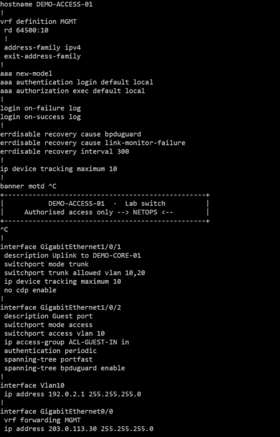
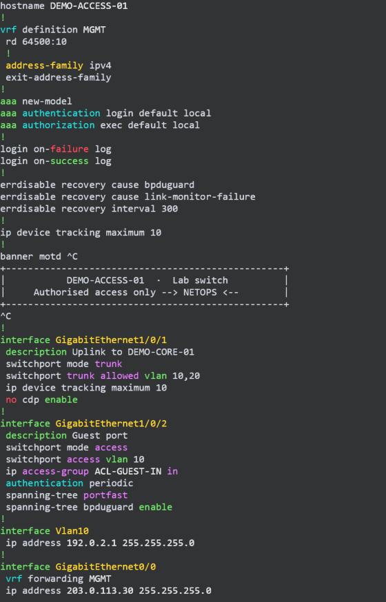
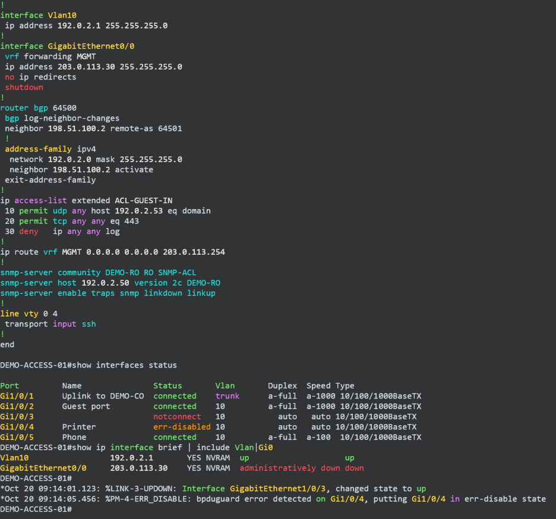
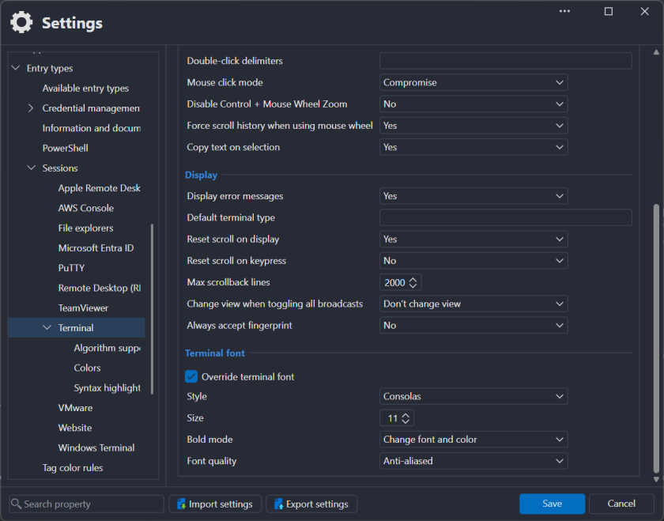
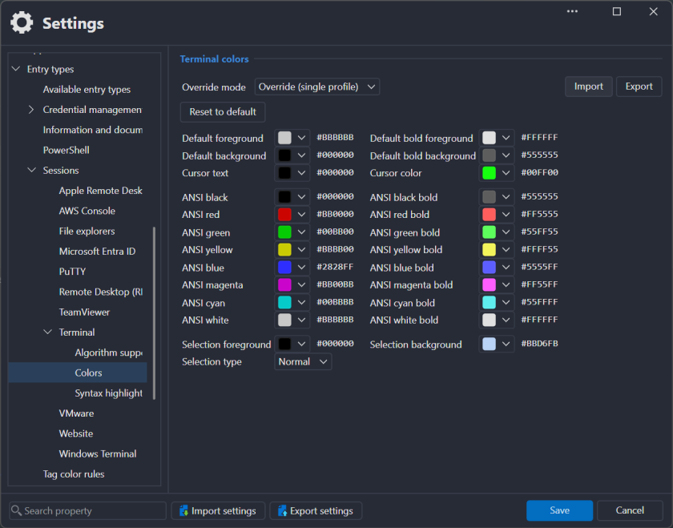
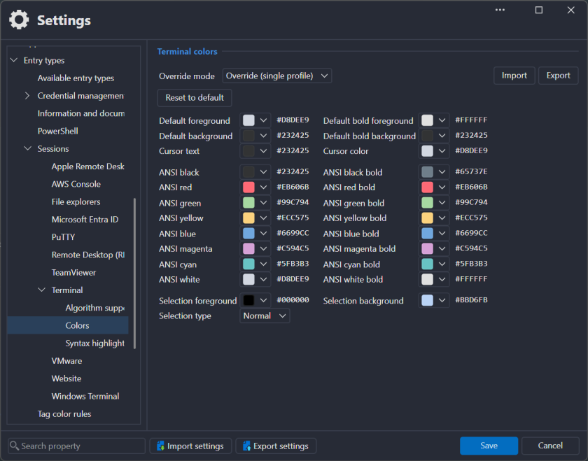
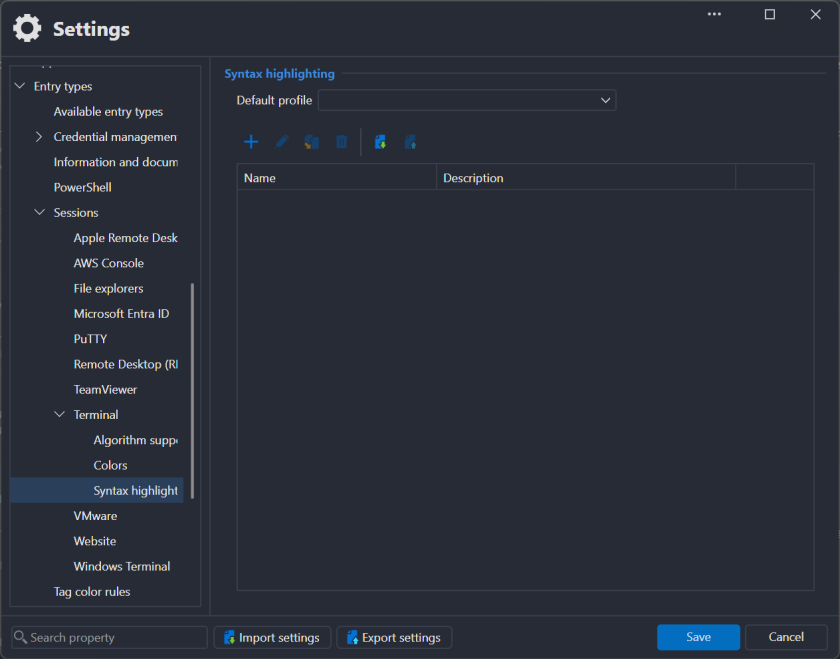
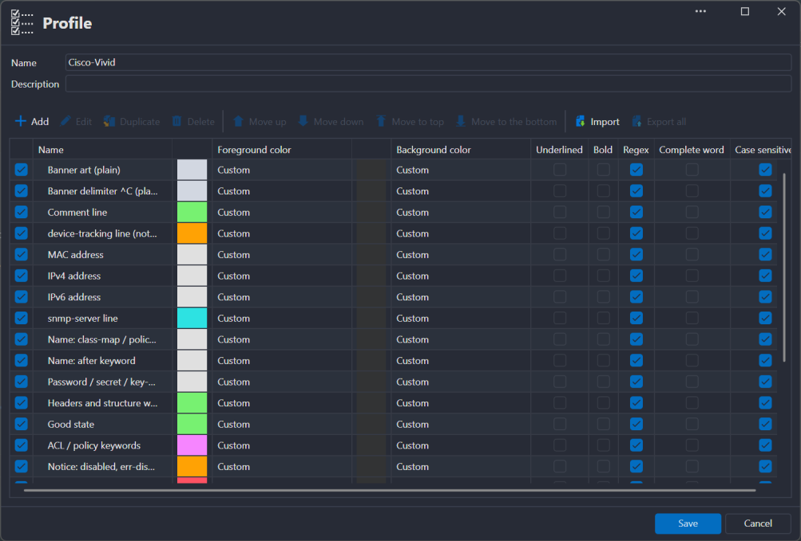
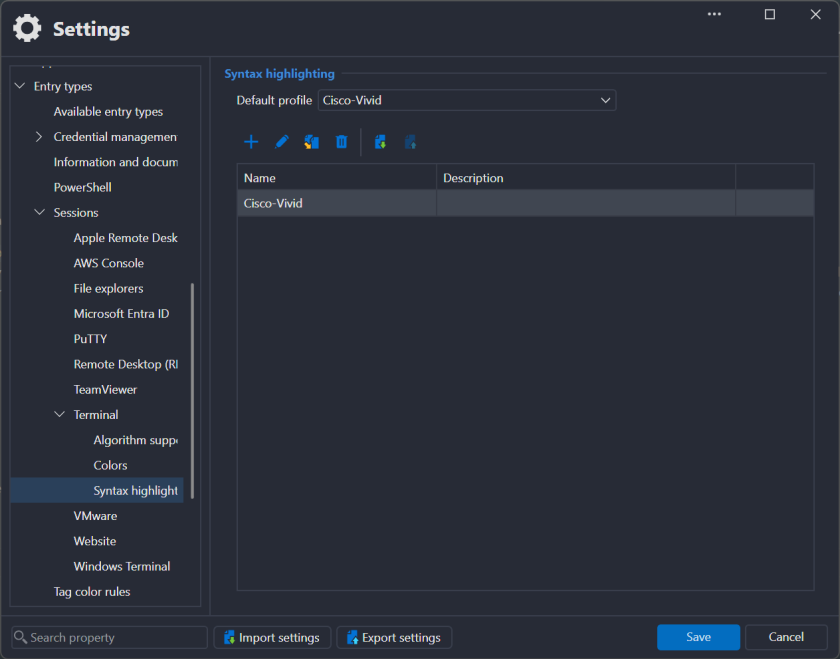

# Cisco Syntax Highlighting for Remote Desktop Manager

**Read Cisco IOS / IOS-XE configs and `show` output in Devolutions Remote Desktop Manager the way you
read them in your editor:** interfaces, keywords, your own names and addresses, and anything that's
down or disabled stand out at a glance — in every SSH session, on every switch.

| Plain RDM | With this profile |
| --- | --- |
|  |  |

- **The same colours as your editor.** The palette comes from the
  [Cisco IOS/IOS-XE IntelliSense](https://marketplace.visualstudio.com/items?itemName=Aswertus.cisco-ios-lsp)
  extension for VS Code, so a config looks the same while you write it and on the live switch.
- **Just two files to import.** A highlighting profile for RDM, plus optional terminal colours. No
  plugin, no script, nothing that runs.
- **Made for real output.** Whole-word matching, case-sensitive, tuned on production configs: no
  colour bleeding into the rest of the line, no `Fa`/`Te`/`Lo` prefixes lighting up `Failed`,
  `Telnet` or `Local`.

---

## Features

### Config structure at a glance

Interfaces in yellow, block keywords in green, options like `access`, `trunk`, `in` or `portfast` in
violet, protocols in teal. Your own values — IP and MAC addresses, host, VRF, ACL and class-map
names, secrets — stay bright, so they're easy to find in a long config.

### Problems stand out

`no …` lines, `shutdown`, `deny`, `down`, `notconnect` and `failure` are red; `disabled`,
`err-disabled` and device-tracking lines orange; `up`, `connected`, `permit` and `success` green.
That works in `show` output too:

### Quiet where it should be

Banner art, descriptions and everything the profile has no opinion about keep the terminal's normal
text colour. `snmp-server` lines are coloured as a whole, with their addresses still standing out.

| Colour | What                                                                                                                                         |
| ------ | -------------------------------------------------------------------------------------------------------------------------------------------- |
| green  | `interface`, `description`, `vlan`, `aaa`, table headers; good state (`up`, `permit`, `connected`, `success`); `!` lines                     |
| red    | `no …`, bad state (`down`, `deny`, `shutdown`, `notconnect`, `failure`), `--More--`                                                          |
| orange | notices: `disabled`, `err-disabled`, `device-tracking` lines                                                                                 |
| violet | ACL / policy keywords (`access-group`, `route-map`, `class-map`, …) and options (`access`, `trunk`, `in`, `any`, `match-all`, `portfast`, …) |
| teal   | protocols (`ssh`, `tcp`, `bgp`, `ospf`, `vrf`, …), `authentication`/`authorization`/`accounting`, whole `snmp-server` lines                  |
| yellow | interfaces (`GigabitEthernet1/0/1`, `Vlan10`, `Po1`, `LISP0.100`, ranges `Gi1/0/1-3`, …), `line con/vty`, `address-family`                   |
| white  | your values: IPv4/IPv6/MAC addresses, host/ACL/VRF/class-map names, secrets                                                                  |
| plain  | banner art and everything else                                                                                                               |

---

## Getting started

Download the [latest release](../../releases/latest) (zip) and pick the folder that matches your
terminal:

| Folder                                      | For a terminal with                   | Files                                                              |
| ------------------------------------------- | ------------------------------------- | ------------------------------------------------------------------ |
| [`default-background/`](default-background) | RDM's default black background        | `RDM-Cisco-Vivid.xml`                                              |
| [`vscode-background/`](vscode-background)   | VS Code's dark background (`#232425`) | `RDM-Cisco-Vivid.xml` + `Daybreak-RDM-Dark.txt` (terminal colours) |

Every rule paints its own background in that colour, so the other folder's profile would show boxes
behind coloured words.

All settings are under **File → Settings → Entry Types → Sessions → Terminal** (RDM 2026.3, Windows).

**1. Font.** On the _General_ tab, under _Terminal font_: tick **Override terminal font**, _Style_
**Consolas**, _Size_ **11**, _Bold mode_ **Change font and color**, _Font quality_ **Anti-aliased**.
RDM's default terminal font is thin enough to wash every colour out.

**2. Terminal colours** _(vscode-background only)_. **Colors** → _Override mode:_ **Override (single
profile)** → **Import** → `Daybreak-RDM-Dark.txt`. Export your current colours first if you may want
to go back.

| Before (RDM default) | After the import |
| --- | --- |
|  |  |

**3. A new profile.** **Syntax highlighting** → **+** → name it, e.g. `Cisco-Vivid`.

**4. The rules.** Inside that profile's rule list: **Import** → `RDM-Cisco-Vivid.xml` → **Save**. All
24 rules show _Custom_ colours.

**5. Use it everywhere.** Back on **Syntax highlighting**, set _Default profile_ to **Cisco-Vivid** →
**Save**. Every SSH session now uses it. To use it on some entries only, leave the default empty and
pick the profile in the entry's **Terminal → Display** instead.

Connect to a switch and run `show running-config`.

---

## Good to know

- **Import adds rules below the existing ones**, and the rule higher up wins. Import into an empty
  profile; to update, delete the old rules first.
- **Import inside the profile's rule list.** On the list of profiles RDM answers
  `<SyntaxHighlightingItemList> was not expected`.
- **Banners.** RDM colours one line at a time, so banner lines are recognised by their first
  character (`|`, `+`, `*`, …). A banner line starting with a letter is coloured like config.

## Related

- **[Cisco IOS/IOS-XE IntelliSense](https://marketplace.visualstudio.com/items?itemName=Aswertus.cisco-ios-lsp)**
  for VS Code ([Open VSX](https://open-vsx.org/extension/Aswertus/cisco-ios-lsp) ·
  [GitHub](https://github.com/Aswertus/cisco-lsp)): completions, hover docs, error checking and
  rename for Cisco configs — where these colours come from.

## Credits

The rule set started from
[alalexiev's Cisco IOS / IOS-XE / IOS-XR highlighting profile](https://forum.devolutions.net/topics/35196/cisco-ios--iosxe--iosxr-syntax-highlighting)
on the Devolutions forum (2021). Its word lists were repaired and extended with the VS Code
extension's keyword set.

Not affiliated with Devolutions or Cisco. _Remote Desktop Manager_ is a product of Devolutions Inc.;
_Cisco_ and _IOS_ are trademarks of Cisco Systems, Inc.

## License

[MIT](LICENSE)
